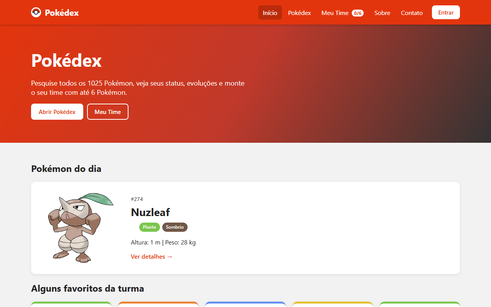
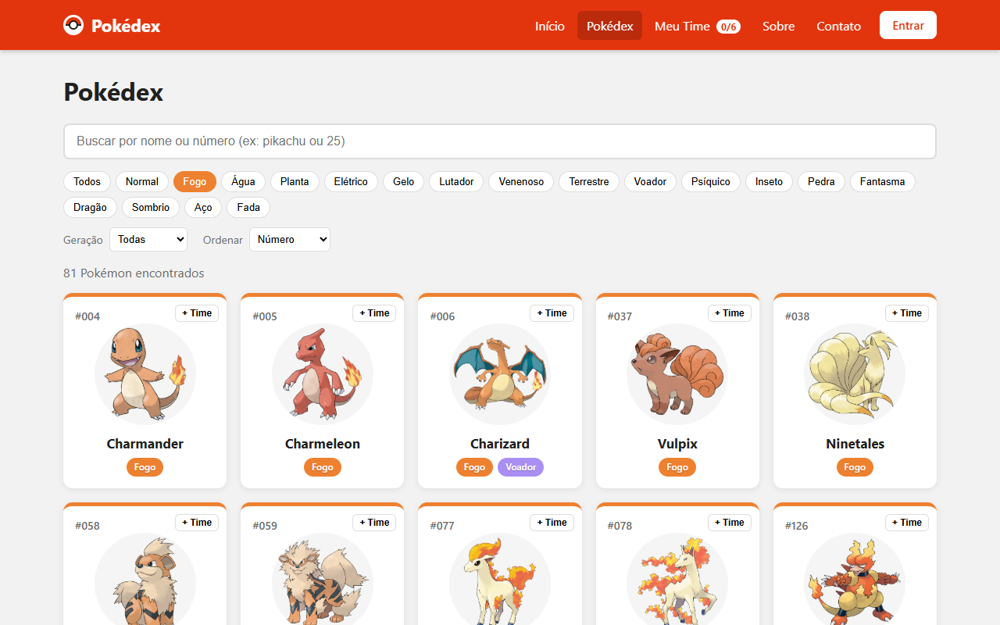
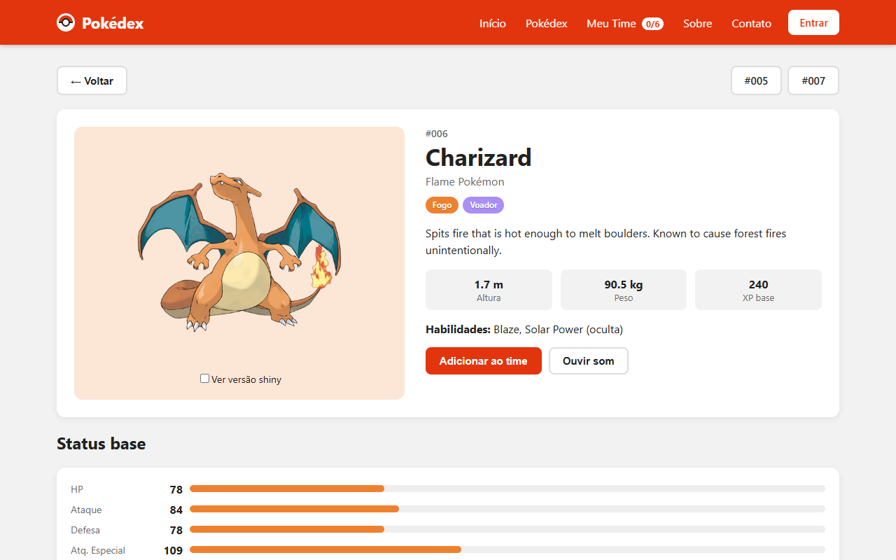
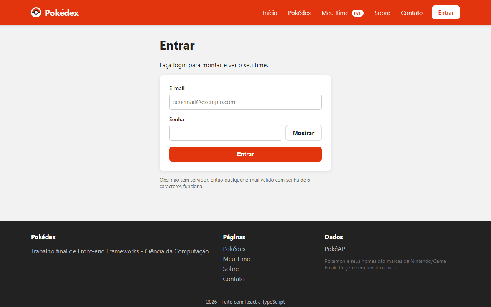
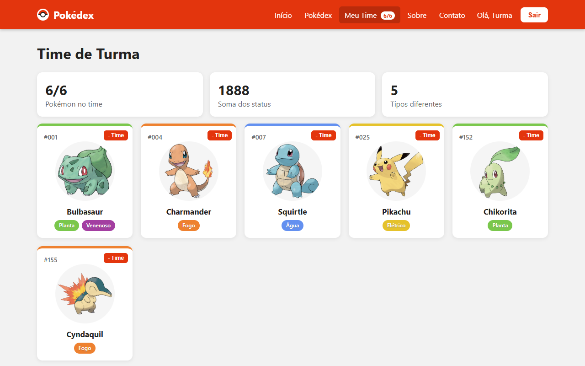
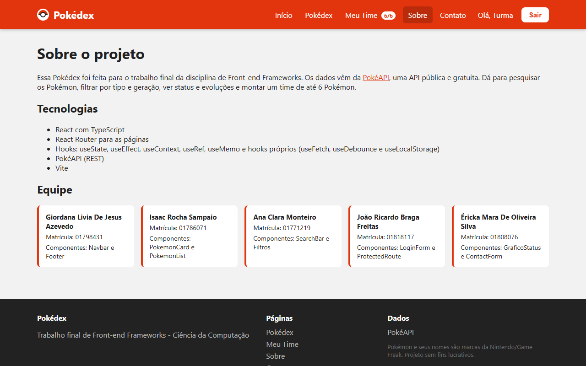
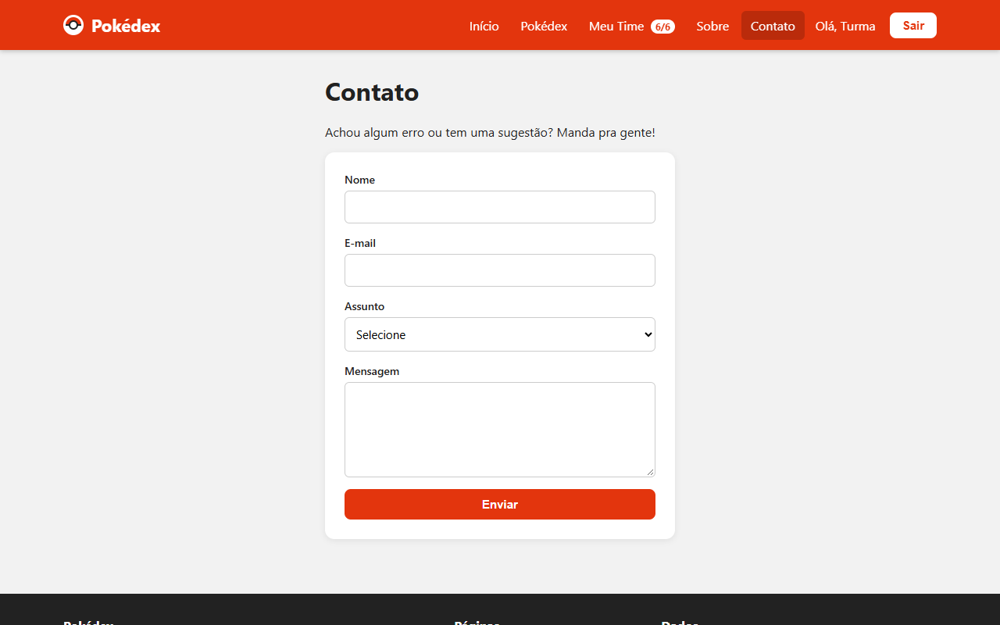
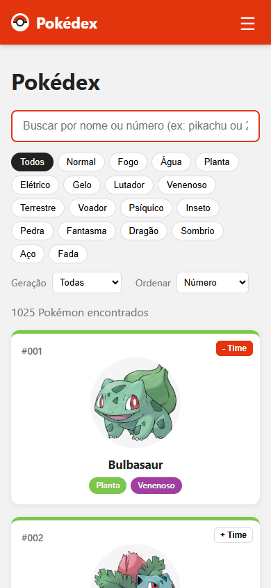

# Pokédex - Trabalho Final de Front-end Frameworks

Projeto da AV2 da disciplina de Front-end Frameworks (Ciência da Computação), feito em React com TypeScript.

É uma Pokédex que usa a [PokéAPI](https://pokeapi.co). Dá para pesquisar os 1025 Pokémon, filtrar por tipo e geração, ver os detalhes de cada um (status, habilidades, evoluções e o som) e montar um time de até 6 Pokémon. A página do time só abre depois de fazer login.

## Integrantes

| Nome | Matrícula | Componentes |
|---|---|---|
| Giordana Livia De Jesus Azevedo | 01798431 | Navbar, Footer |
| Isaac Rocha Sampaio | 01786071 | PokemonCard, PokemonList |
| Ana Clara Monteiro | 01771219 | SearchBar, Filtros, LoginForm, ProtectedRoute |
| Éricka Mara De Oliveira Silva | 01808076 | GraficoStatus, ContactForm |

Os componentes ficam na pasta `src/components`.

## Tecnologias

- React 18 + TypeScript
- React Router DOM
- Vite
- PokéAPI

## Como rodar o projeto

Precisa ter o Node.js instalado (versão 18 ou maior).

```bash
git clone <link-do-repositorio>
cd <nome-da-pasta>
npm install
npm run dev
```

Depois é só abrir `http://localhost:5173` no navegador.

Para gerar a versão de produção:

```bash
npm run build
```

## Como usar

- Na página **Pokédex** você pode buscar pelo nome ou pelo número, filtrar por tipo e por geração e mudar a ordem.
- Clicando em um Pokémon abre a página de detalhes, com status, evoluções e o botão para ouvir o som dele.
- O botão **+ Time** adiciona o Pokémon no seu time (máximo 6).
- A página **Meu Time** pede login. Como o projeto não tem backend, qualquer e-mail válido com senha de 6 caracteres ou mais funciona.

## Requisitos

- **Componentes:** 10 componentes funcionais, 2 de cada integrante (mais o `Loading`).
- **Páginas:** 8 no total.
  - Início (`/`)
  - Pokédex (`/pokedex`)
  - Detalhes (`/pokemon/:id`)
  - Meu Time (`/meu-time`, protegida)
  - Login (`/login`)
  - Sobre (`/sobre`)
  - Contato (`/contato`)
  - 404
- **Hooks:**
  - do React: `useState`, `useEffect`, `useContext`, `useRef`, `useMemo`;
  - criados por nós: `useFetch`, `useDebounce`, `useLocalStorage` (ficam em `src/hooks`).
- **API:** integração com a PokéAPI (REST).
- **Estado global:** Context API, com `AuthContext` para o login e `TimeContext` para o time.

## Prints

### Início


### Pokédex (filtrando por tipo)


### Detalhes


### Login


### Meu Time


### Sobre


### Contato


### Celular

